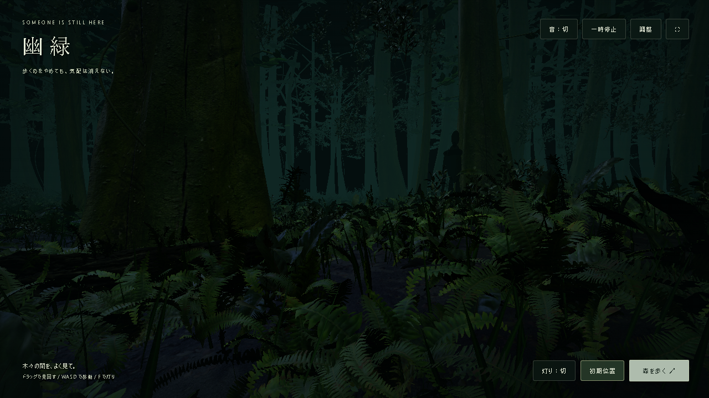

# 幽緑 — 誰かが、まだいる

薄暗い森を歩き、木陰からこちらを見つめる影の気配を感じる、Three.jsの短い環境ホラーです。

影は襲いかかりません。視界に入っている間は立ち止まり、見つめ続けると薄れて隠れ、視線を外した間にゆっくり後をつけます。戦闘・ダメージ・ゲームオーバー・突然の大音量はありません。



## 起動

Node.js 24 以上を使用します。

```sh
npm ci
npm run dev
```

http://127.0.0.1:5178/ を開きます。Windowsでは依存をインストールした後に `start-forest.cmd` をダブルクリックして起動できます。

```sh
npm test       # 影の状態遷移・距離制限・停止を検証
npm run build  # TypeScript検査と本番ビルド
npm run preview
```

`dist/index.html` の直接ダブルクリックでは動作しません。HTTPサーバーで `dist` を配信してください。素材は同梱しており、起動時の外部通信・アカウント・APIキーは不要です。

## 操作

| 操作 | キー / ボタン |
| --- | --- |
| 見回す | マウスドラッグ |
| 歩く | WASD / 矢印キー |
| 少し速く歩く | Shift |
| マウスを固定する | 「森を歩く」。Escで解除 |
| 手元の灯り | F / 「灯り」 |
| 一時停止 / 再開 | P / 「一時停止」 |
| 初期位置へ戻る・影をリセット | R / 「初期位置」 |
| 画面表示を隠す / 戻す | H |
| 視野角 | スクロール |
| 静かな環境音 | 「音：切」を押して有効化 |

「調整」から明るさ、霧、風、画質を変更できます。設定画面・元画像の比較画面・非表示タブでは影の時間も止まります。音は初期状態でオフです。OSの「視差効果を減らす」設定では葉の風揺れも初期状態で停止します。

## 影の動作

- 木のそばに立ち、こちらに顔を向ける。
- カメラの視界内では追従移動しない。
- 数秒見つめ続けるとゆっくり消え、しばらくして視界の外の木陰へ移る。
- 視界の外では徒歩より遅い速度で距離を保って追従する。
- こちらから接近すると退き、8メートル以内に可視状態で残らない。
- 攻撃、接触ダメージ、追跡加速は実装していない。

## 技術

TypeScript / Three.js r180 / Vite。141本の樹木と約4.6万枚の曲面葉、実写由来のシダ・アンスリウム・低木・苔・倒木をインスタンス描画します。2K PBR材質、4Kシダ、森林HDRIの間接光、静的シャドウマップ、距離霧を使用。影は実際の3D形状で、視点移動による視差と樹木による遮蔽があります。

- `src/stalker.ts`：描画から独立した影の状態遷移
- `src/presence-view.ts`：影の形状、視線・幹による遮蔽の判定
- `src/ambience.ts`：低音、風、静かな葉擦れの任意音声
- `src/main.ts`：カメラ、照明、操作、停止制御
- `src/forest.ts` / `src/scans.ts`：植生と実写素材

検証用に `?inspect=1` を付けると、非表示の `#forest-inspection` 要素へカメラ・影・停止状態を書き出します。操作を変更する隠しコマンドはありません。

## 制約

元の生成画像と同等の写真品質には達していません。幹のシルエット、葉の透過散乱、植生の自然な重なりには差があります。影の遮蔽判定は幹の簡易形状を使用し、葉一枚ずつの可視性は判定していません。影は物理キャラクターではなく、木陰に現れる存在として演出しています。

葉の微風と影の形状変化は静的シャドウマップに反映されません。幹への簡易進入防止と地面追従がありますが、倒木との精密な衝突判定はありません。WebGL 2 とハードウェアアクセラレーションが必要です。速度は画面サイズとGPUに依存します。

## 素材

元の生成画像：`public/reference.png`。

以下の Poly Haven [CC0素材](https://polyhaven.com/license)を使用しています。

- [Fern 02](https://polyhaven.com/a/fern_02)
- [Anthurium Botany 01](https://polyhaven.com/a/anthurium_botany_01)
- [Shrub 04](https://polyhaven.com/a/shrub_04)
- [Moss 01](https://polyhaven.com/a/moss_01)
- [Dead Tree Trunk](https://polyhaven.com/a/dead_tree_trunk)
- [Moss Wood](https://polyhaven.com/a/moss_wood)
- [Forest Floor](https://polyhaven.com/a/forest_floor)
- [Mossy Forest](https://polyhaven.com/a/mossy_forest)

素材の取得元・サイズ・MD5は `public/assets/manifest.json` に記録。`download-assets.ps1` で再取得とハッシュ検証ができます。Three.js等のライセンスは各依存パッケージに付属しています。
